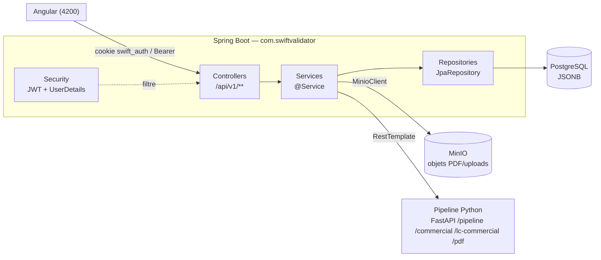
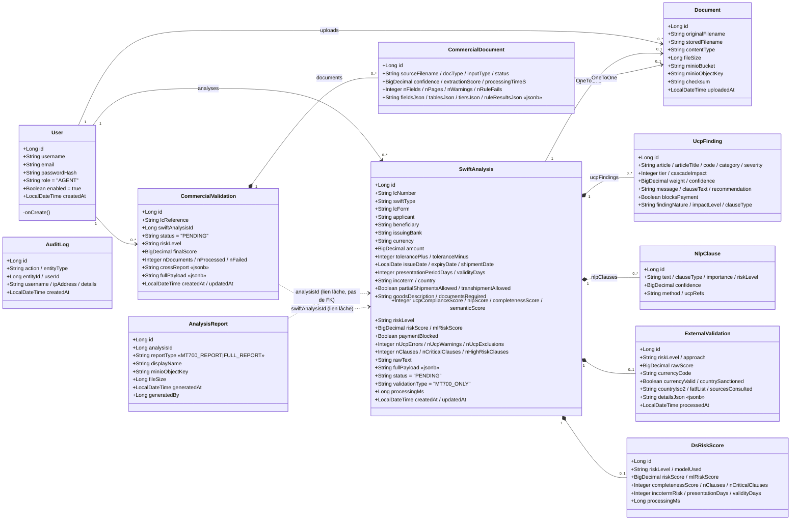
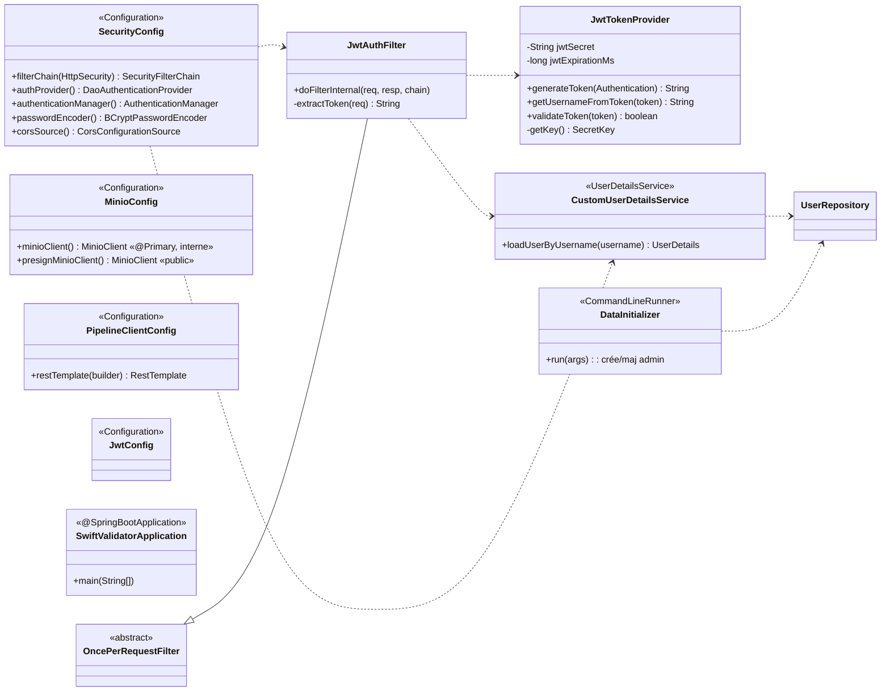

# Swift Validator — Backend : Diagramme de classes complet

Application **Spring Boot 3 / Java (Jakarta)**, organisée en couches
`Controller → Service → Repository → Entity JPA`, avec sécurité JWT, stockage
MinIO (double client interne/public) et délégation à un **pipeline Python (FastAPI)**
pour toute la partie IA (OCR, NER SWIFT, conformité UCP, risque ML, validation croisée).

> Package racine : `com.swiftvalidator`
> Les diagrammes ci-dessous sont en [Mermaid](https://mermaid.js.org/).

---

## 1. Vue d'ensemble (couches & flux externes)

---

## 2. Entités JPA (modèle de domaine)

> Toutes les entités sont annotées `@Entity @Data @Builder @NoArgsConstructor @AllArgsConstructor` (Lombok).
> `AnalysisReport.analysisId` et `CommercialValidation.swiftAnalysisId` référencent `SwiftAnalysis` par **id brut** (pas de relation JPA) — dépendance volontairement lâche.

---

## 3. Couche applicative (Controllers, Services, Repositories)

```mermaid
classDiagram
    direction TB

    %% ───────── CONTROLLERS ─────────
    class AuthController {
        +login(LoginRequest, resp) AuthResponse
        +logout(resp) void
        +me(UserDetails) AuthResponse
    }
    class SwiftAnalysisController {
        +upload(MultipartFile, UserDetails) AnalysisResponseDTO
        +getById(Long, UserDetails)
        +list(page,size,riskLevel,lcNumber,UserDetails) Page
        +rawPayload(Long, UserDetails)
    }
    class CommercialValidationController {
        +validate(List~MultipartFile~, lcRef, swiftAnalysisId, UserDetails)
        +getById(Long, UserDetails)
        +list(page,size,riskLevel,lcRef,UserDetails) Page
    }
    class LcCrossValidationController {
        +validate(swiftAnalysisId, commercialValidationId, UserDetails)
    }
    class ReportController {
        +generateMt700(Long, UserDetails)
        +generateFull(Long, commercialValidationId, UserDetails)
        +listReports(Long)
        +refreshUrl(Long)
        +adminAllReports(type)
    }
    class AdminController {
        +getStats()
        +getAgents()
        +createAgent(CreateAgentRequest)
        +updateAgent(Long, UpdateAgentRequest)
        +toggleStatus(Long, ToggleStatusRequest)
        +deleteAgent(Long)
        +getAgentHistory(Long)
    }
    class DashboardController {
        +stats(UserDetails) DashboardStatsDTO
    }
    class IntegrationHealthController {
        +integrationHealth() Map
        -dbCheck() / minioCheck() / pythonCheck()
    }
    class GlobalExceptionHandler
    class ApiExceptionHandler

    %% ───────── SERVICES ─────────
    class AnalysisService {
        +analyzeFile(MultipartFile, username) AnalysisResponseDTO
        +getById(Long, username)
        +listByUser(username, Pageable)
        +search(username, riskLevel, lcNumber, Pageable)
        +getDashboardStats(username) DashboardStatsDTO
        -buildAnalysis(JsonNode, User, Document) SwiftAnalysis
    }
    class CommercialValidationService {
        +validate(files, username, lcRef)
        +getById / list / search
        +toDTO(CommercialValidation, includePayload)
        -buildValidation(JsonNode, User, files, lcRef)
    }
    class LcCrossValidationService {
        +validate(swiftAnalysisId, commercialValidationId, username)
        +rawCoherence(...) JsonNode
        -buildLcPayload / buildCommercialPayload
    }
    class ReportService {
        +generateMt700Report(analysisId, username)
        +generateFullReport(analysisId, commercialValidationId, username)
        +listReports(analysisId)
        +freshDownloadUrl(reportId)
        -callPythonPdf(path, payload)
        -presignedUrl(objectKey)
    }
    class DocumentStorageService {
        +store(MultipartFile, User) Document
        +getFile(objectKey) InputStream
        -ensureBucket()
    }
    class AdminService {
        +getStats() / getAgents() / createAgent()
        +updateAgent() / toggleStatus() / deleteAgent()
        +getAgentHistory(agentId)
    }
    class UserService {
        +findByUsername(username) Optional~User~
        +save(User)
    }
    class PipelineClientService {
        +analyze(MultipartFile) JsonNode
        +analyzeCommercialDocuments(files) JsonNode
        +callLcCommercialValidate(Map) JsonNode
        -validateContract(JsonNode)
    }
    class AnalysisMapper {
        +toDTO(SwiftAnalysis, includeRawPayload) AnalysisResponseDTO
        -extractRiskMl / extractSwiftValidation / extractSemanticValidation ...
    }

    %% ───────── REPOSITORIES (JpaRepository) ─────────
    class UserRepository {
        <<interface>>
        findByUsername / findByEmail
        existsByUsername / existsByEmail
        findByRoleNot / countActiveAgents
    }
    class SwiftAnalysisRepository {
        <<interface>>
        findByIdAndUserId / search
        countByUserId / countSince / avgUcpScore
        countByRiskLevelIn / countByDaySince
    }
    class CommercialValidationRepository {
        <<interface>>
        findByIdAndUserId / search / countByUserId
    }
    class DocumentRepository {
        <<interface>>
    }
    class NlpClauseRepository {
        <<interface>>
    }
    class UcpFindingRepository {
        <<interface>>
    }
    class AnalysisReportRepository {
        <<interface>>
        findByAnalysisIdOrderByGeneratedAtDesc
    }
    class AuditLogRepository {
        <<interface>>
    }

    %% ── Controller → Service ──
    AuthController ..> JwtTokenProvider
    AuthController ..> UserRepository
    SwiftAnalysisController ..> AnalysisService
    CommercialValidationController ..> CommercialValidationService
    LcCrossValidationController ..> LcCrossValidationService
    ReportController ..> ReportService
    AdminController ..> AdminService
    DashboardController ..> AnalysisService
    IntegrationHealthController ..> PipelineClientService

    %% ── Service → Service / Repo ──
    AnalysisService ..> PipelineClientService
    AnalysisService ..> DocumentStorageService
    AnalysisService ..> AnalysisMapper
    AnalysisService ..> SwiftAnalysisRepository
    AnalysisService ..> UcpFindingRepository
    AnalysisService ..> NlpClauseRepository
    AnalysisService ..> UserRepository
    AnalysisService ..> AuditLogRepository

    CommercialValidationService ..> PipelineClientService
    CommercialValidationService ..> DocumentStorageService
    CommercialValidationService ..> CommercialValidationRepository
    CommercialValidationService ..> DocumentRepository
    CommercialValidationService ..> UserRepository
    CommercialValidationService ..> AuditLogRepository

    LcCrossValidationService ..> PipelineClientService
    LcCrossValidationService ..> SwiftAnalysisRepository
    LcCrossValidationService ..> CommercialValidationRepository
    LcCrossValidationService ..> UserRepository

    ReportService ..> AnalysisReportRepository
    ReportService ..> SwiftAnalysisRepository
    ReportService ..> CommercialValidationRepository
    ReportService ..> UserRepository
    ReportService ..> LcCrossValidationService

    AdminService ..> UserRepository
    AdminService ..> SwiftAnalysisRepository
    UserService ..> UserRepository
```

---

## 4. Sécurité & Configuration

---

## 5. DTOs (conteneurs Lombok `@Builder` avec sous-types imbriqués)

| DTO racine | Sous-types imbriqués notables |
|---|---|
| **AnalysisResponseDTO** | UcpFindingDTO, NlpClauseDTO, ExternalValidationDTO, ExternalDetailsDTO, ExternalCountryDTO, ExternalCurrencyDTO, DsRiskScoreDTO, RiskMlDTO, ShapFeatureDTO, ShapWaterfallItemDTO, ScoreBreakdownDTO, ExplanationDTO, RuleContributionDTO, TopDimensionDTO, MissingFieldItemDTO, UcpDetailDTO, UcpViolationDTO, SwiftValidationDTO, SwiftFieldValidationDTO, SemanticValidationDTO, SemanticItemDTO, CrossFieldIssueDTO |
| **CommercialValidationResponseDTO** | SummaryDTO, DocumentResultDTO, RuleSummaryDTO, CrossReportDTO |
| **LcCrossValidationResponseDTO** | LcSummaryDTO, CommercialSummaryInfo |
| **AdminDTO** | AdminStatsResponse, AgentResponse, AnalysisHistoryItem, DayCount, DecisionSegment, CreateAgentRequest, UpdateAgentRequest, ToggleStatusRequest |
| **AuthDTO** | LoginRequest, RegisterRequest, AuthResponse |
| **ReportDTO** | GenerateRequest, ReportResponse |
| **DashboardStatsDTO** | (plat : totalAnalyses, criticalCount, … avgUcpScore) |

---

## 6. Points d'architecture clés

- **Couches strictes** : `Controller` (REST, validation des fichiers, `@AuthenticationPrincipal`) → `Service` (`@Transactional`) → `Repository` (Spring Data JPA) → `Entity`.
- **L'IA n'est pas dans le Java** : tout passe par `PipelineClientService` (RestTemplate) vers le pipeline Python `swift-validator-ia`. Le JSON brut est stocké tel quel dans les colonnes `fullPayload` / `crossReport` (`jsonb`) puis re-parsé à la demande par `AnalysisMapper` et les services.
- **Deux clients MinIO** : `minioClient` (interne, upload serveur) et `presignMinioClient` (`@Qualifier("presignMinioClient")`, endpoint public pour URLs présignées 7 jours).
- **Sécurité** : JWT stateless, lu depuis le cookie `swift_auth` **ou** l'en-tête `Bearer` ; rôles `ADMIN` / `AGENT` ; `/api/v1/admin/**` protégé par `hasRole('ADMIN')` ; admin auto-créé au démarrage par `DataInitializer`.
- **Liens lâches volontaires** : `AnalysisReport.analysisId` et `CommercialValidation.swiftAnalysisId` ne sont pas des relations JPA mais des références par id.
