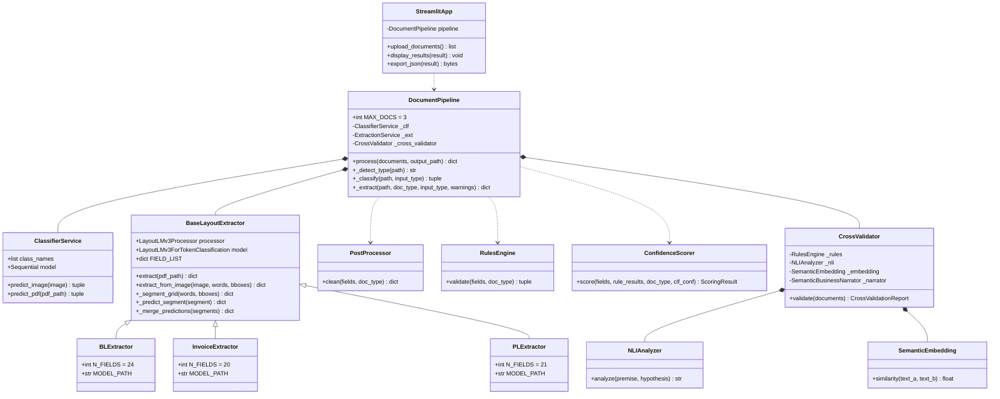

# Swift Validator IA — Release 2

Pipeline IA de validation de documents commerciaux (Bill of Lading, Invoice, Packing List).
Classification visuelle ResNet-18 + extraction de champs LayoutLMv3 + validation inter-documents
avec NLI DeBERTa et règles métier UCP/INCOTERM.

---

## Table des matières

1. [Vue d'ensemble](#vue-densemble)
2. [Architecture générale](#architecture-générale)
3. [Structure des fichiers](#structure-des-fichiers)
4. [Modèles IA](#modèles-ia)
5. [Services détaillés](#services-détaillés)
6. [Validation inter-documents](#validation-inter-documents)
7. [Pipeline d'entraînement](#pipeline-dentraînement)
8. [Générateur de données synthétiques](#générateur-de-données-synthétiques)
9. [Interface Streamlit](#interface-streamlit)
10. [API Python](#api-python)
11. [Format de sortie JSON](#format-de-sortie-json)
12. [Installation et lancement](#installation-et-lancement)
13. [Diagramme UML](#diagramme-uml)

---

## Vue d'ensemble

Release 2 traite des **dossiers de commerce international** composés de trois documents :

| Document | Abréviation | Champs extraits | Modèle spécialisé |
|---|---|---|---|
| Bill of Lading | BL | 24 | `best_bl` (48 labels) |
| Commercial Invoice | INV | 20 | `best_invoice` (40 labels) |
| Packing List | PL | 21 | `best_pl` (42 labels) |

**Capacités clés :**

| Capacité | Statut | Détail |
|---|---|---|
| Classification automatique BL / Invoice / PL | Termine | ResNet-18 + fallback keywords |
| Extraction champs PDF natif | Termine | pdfplumber + LayoutLMv3 specialise |
| Extraction champs PDF scanne / Image | Termine | EasyOCR + LayoutLMv3 |
| Post-traitement et normalisation | Termine | Prefixes labels, whitespace, dates, montants |
| Validation regles single-doc | Termine | 20+ regles (checksum container, dates, incoterms) |
| Validation inter-documents | Termine | 14 regles + NLI DeBERTa + embeddings MiniLM |
| Scoring de confiance multi-composant | Termine | couverture x qualite x regles x classifieur |
| Interface web Streamlit | Termine | Upload multi-fichiers, XAI, export JSON |
| Generation donnees synthetiques | Termine | 64 layouts x 6 100 documents |
| Pipeline entrainement end-to-end | Termine | Scripts 00 a 05 |
| Explainabilite IA | Termine | Confidence breakdown par champ + raisons violations |

---

## Architecture generale

```
Fichiers (PDF natif / PDF scanne / Image)
              |
              v
    DocumentPipeline.process()
              |
    +---------+----------------------------------------+
    |   ThreadPoolExecutor (max 3 workers)              |
    |                                                   |
    |   Pour chaque document :                          |
    |                                                   |
    |   1. _detect_type()                               |
    |      -> pdf_native | pdf_scanned | image          |
    |                                                   |
    |   2. _classify()                                  |
    |      +- KeywordClassifier (zero-ML)               |
    |      +- ResNet-18 (vision)                        |
    |         -> (doc_type, confidence)                 |
    |                                                   |
    |   3. _extract()                                   |
    |      +- [natif]   pdfplumber                      |
    |      |            + BL/Invoice/PLExtractor        |
    |      +- [scanne]  EasyOCR                         |
    |                   + BL/Invoice/PLExtractor        |
    |         -> {champ: valeur, ...}                   |
    |                                                   |
    |   4. PostProcessor.clean()                        |
    |      + RulesEngine.validate()                     |
    |      + ConfidenceScorer.score()                   |
    +---------------------------------------------------+
              |
    CrossValidator.validate()
    (si >= 2 documents)
    +- RulesEngine      (14 regles, poids 0.55)
    +- NLIAnalyzer      (DeBERTa,   poids 0.25)
    +- SemanticParties  (MiniLM,    poids 0.20)
              |
              v
    PipelineResult { summary, documents[] }
              |
              v
    StreamlitApp -- affichage
```

---

## Structure des fichiers

```
release2/
|
+-- app/
|   +-- streamlit_app.py          # Interface web (upload, XAI, export JSON)
|   +-- requirements.txt          # Dependances Python
|   +-- run.bat                   # Lancement rapide Windows
|
+-- data/
|   +-- dataset/                  # Dataset JSONL pour LayoutLMv3
|   |   +-- train/data.jsonl      # 4 880 pages
|   |   +-- val/data.jsonl        # 610 pages
|   |   +-- test/data.jsonl       # 610 pages
|   |   +-- id2label.json         # 48 labels NER
|   |   +-- label2id.json
|   |   +-- stats.json            # 6 100 docs, distribution des labels
|   +-- raw/                      # PDFs synthetiques bruts + annotations
|   |   +-- bl/
|   |   +-- invoice/
|   |   +-- packing_list/
|   +-- processed/                # {_bio.json, _ocr.json, _page1.png} par doc
|       +-- bl/
|       +-- invoice/
|       +-- packing_list/
|
+-- document_generator/
|   +-- generate_bl.py            # BLGenerator -- donnees realistes + BLParametricRenderer
|   +-- generate_invoice.py       # InvoiceGenerator -- derive du BLDossier
|   +-- generate_packing_list.py  # PLGenerator -- derive du BLDossier
|   +-- data_pools.py             # Pools : armateurs, ports, conteneurs, marchandises
|   +-- dataset_stats.py          # Statistiques du dataset genere
|   +-- label_studio_export.py    # Export Label Studio (OCR + classification)
|   +-- layout_engine/
|       +-- config.py             # 64 layouts (22 BL + 21 INV + 21 PL)
|       +-- color_schemes.py      # Palettes : navy, crimson, forest, amber, teal...
|       +-- renderer_bl.py        # BLParametricRenderer (5 styles d'en-tete)
|       +-- renderer_inv.py       # InvoiceParametricRenderer
|       +-- renderer_pl.py        # PLParametricRenderer
|
+-- models/
|   +-- doc_classifier/           # ResNet-18 (best_model.pt + class_names.json)
|   +-- layoutlmv3-finetuned/     # Modele generique 48 labels (best/)
|   +-- models_layout/
|       +-- best_bl/best_bl/      # LayoutLMv3 specialise BL (48 labels)
|       +-- best_invoice/best_invoice/  # LayoutLMv3 specialise Invoice (40 labels)
|       +-- best_pl/best_pl/      # LayoutLMv3 specialise PL (42 labels)
|
+-- scripts/
|   +-- 00_generate_dataset.py    # Etape 0 : generation synthetique
|   +-- 01_ocr_extract.py         # Etape 1 : extraction OCR
|   +-- 02_annotate_bio.py        # Etape 2 : annotation BIO
|   +-- 03_build_dataset.py       # Etape 3 : construction JSONL
|   +-- 04_finetune_layoutlm.py   # Etape 4 : fine-tuning LayoutLMv3
|   +-- 05_train_classifier.py    # Etape 5 : entrainement ResNet-18
|   +-- train_ensemble.py         # Bonus : ensemble voting
|
+-- services/
    +-- __init__.py               # Exports API publique
    +-- pipeline.py               # DocumentPipeline -- orchestrateur principal
    +-- classifier_service.py     # ClassifierService -- ResNet-18
    +-- extraction_service.py     # ExtractionService -- LayoutLMv3 generique
    +-- post_processor.py         # PostProcessor -- normalisation champs
    +-- native_extractor.py       # NativeExtractor -- regex PDF natif (zero ML)
    +-- keyword_classifier.py     # classify_text() -- zero ML
    +-- layout_analyzer.py        # LayoutAnalyzer -- zones + tables (DBSCAN)
    +-- feature_builder.py        # FeatureBuilder -- features multimodales
    +-- confidence_scorer.py      # ConfidenceScorer -- score global multi-composant
    +-- rules_engine.py           # RulesEngine -- validation single-doc
    +-- semantic_analyzer.py      # Analyse semantique blocs (HEADER/PARTY/CARGO)
    +-- spacy_enricher.py         # SpaCyEnricher -- enrichissement NER
    +-- template_matcher.py       # TemplateMatcher -- matching format doc
    +-- block_segmenter.py        # Segmentation blocs via PyMuPDF
    +-- zone_extractor.py         # Extraction par zones spatiales
    +-- spatial_extractor.py      # Analyse relations spatiales
    +-- donut_service.py          # DonutService -- modele end-to-end alternatif
    +-- _base_layout_extractor.py # BaseLayoutExtractor -- base partagee extracteurs
    +-- type_classification/
    |   +-- classifier.py         # TypeClassifier avance (keyword + ResNet)
    +-- bl_extractor/
    |   +-- bl_extraction_service.py      # BLExtractor (best_bl, 24 champs)
    +-- invoice_extractor/
    |   +-- invoice_extraction_service.py # InvoiceExtractor (best_invoice, 20 champs)
    +-- pl_extractor/
    |   +-- pl_extraction_service.py      # PLExtractor (best_pl, 21 champs)
    +-- cross_validator/
        +-- cross_validator.py            # CrossValidator -- 7 couches de validation
        +-- rules_engine.py               # 14 regles inter-documents
        +-- nli_analyzer.py               # NLIAnalyzer -- DeBERTa entailment/contradiction
        +-- semantic_embedding.py         # SemanticEmbedding -- MiniLM-L6-v2
        +-- semantic_business_narrator.py # Narrateur metier (textes enrichis)
        +-- field_router.py               # Construction des paires champs pour NLI
```

---

## Modeles IA

### Classificateur visuel -- ResNet-18

| Parametre | Valeur |
|---|---|
| Architecture | ResNet-18 + FC(512 -> 128 -> 3) |
| Input | Image 224x224, normalisation ImageNet |
| Classes | `bl`, `invoice`, `packing_list` |
| DPI de rendu PDF | 150 |
| Chemin | `models/doc_classifier/best_model.pt` |

Strategie de classification en cascade :
1. **KeywordClassifier** (zero ML) -- mots-cles exclusifs avec scoring pondere
2. **ResNet-18** (vision) -- pour PDFs scannes et images

### Extracteurs LayoutLMv3 -- Specialises par type de document

Tous les extracteurs heritent de `BaseLayoutExtractor` et utilisent une segmentation en grille :
`header_left / header_right / body_left / body_right / footer`.

#### BLExtractor -- `models/models_layout/best_bl/best_bl/`

| Champ | Description |
|---|---|
| `BL_NUMBER` | Numero du connaissement |
| `SHIPPER` | Expediteur |
| `CONSIGNEE` | Destinataire |
| `NOTIFY_PARTY` | Partie a notifier |
| `VESSEL` | Navire |
| `VOYAGE` | Numero de voyage |
| `PORT_OF_LOADING` | Port de chargement |
| `PORT_OF_DISCHARGE` | Port de dechargement |
| `PLACE_OF_RECEIPT` | Lieu de reception |
| `PLACE_OF_DELIVERY` | Lieu de livraison |
| `ETD` | Date de depart estimee |
| `ETA` | Date d'arrivee estimee |
| `ISSUE_DATE` | Date d'emission |
| `ISSUE_PLACE` | Lieu d'emission |
| `CONTAINER_NO` | Numero de conteneur |
| `CONTAINER_TYPE` | Type de conteneur |
| `SEAL_NO` | Numero de scelle |
| `COMMODITY` | Marchandise |
| `GROSS_WEIGHT` | Poids brut |
| `MEASUREMENT` | Mesure / CBM |
| `PACKAGES` | Nombre de colis |
| `FREIGHT_TERMS` | Termes de fret |
| `SERVICE_TYPE` | Type de service |
| `NUMBER_OF_ORIGINALS` | Nb d'originaux |
| `containers` *(table)* | Lignes multi-conteneurs |

#### InvoiceExtractor -- `models/models_layout/best_invoice/best_invoice/`

`INV_NUMBER`, `ISSUE_DATE`, `LC_REF`, `BL_REF`, `SELLER`, `BUYER`,
`VESSEL`, `VOYAGE`, `PORT_OF_LOADING`, `PORT_OF_DISCHARGE`,
`GOODS_DESC`, `HS_CODE`, `QUANTITY`, `PACKAGE_UNIT`, `GROSS_WEIGHT`,
`UNIT_PRICE`, `CURRENCY`, `TOTAL_AMOUNT`, `INCOTERM`, `PAYMENT_TERMS`
+ `invoice_items` *(table de lignes)*

#### PLExtractor -- `models/models_layout/best_pl/best_pl/`

`PL_NUMBER`, `ISSUE_DATE`, `INV_REF`, `BL_REF`, `EXPORTER`, `CONSIGNEE`,
`VESSEL`, `VOYAGE`, `PORT_OF_LOADING`, `PORT_OF_DISCHARGE`,
`CONTAINER_NO`, `CONTAINER_TYPE`, `SEAL_NO`, `GOODS_DESC`, `PACKAGE_UNIT`,
`TOTAL_PACKAGES`, `NET_WEIGHT`, `GROSS_WEIGHT`, `TOTAL_CBM`, `MARKS_NUMBERS`, `DIMENSIONS`
+ `packages` *(table de conditionnement)*

### Labels NER (48 au total)

```
O  (outside)
B-/I- x 47 entites :
  BL_NUMBER, SHIPPER, CONSIGNEE, NOTIFY_PARTY, VESSEL, VOYAGE,
  PORT_OF_LOADING, PORT_OF_DISCHARGE, PLACE_OF_RECEIPT, PLACE_OF_DELIVERY,
  ETD, ETA, ISSUE_DATE, ISSUE_PLACE, CONTAINER_NO, CONTAINER_TYPE, SEAL_NO,
  COMMODITY, GROSS_WEIGHT, MEASUREMENT, PACKAGES, FREIGHT_TERMS, SERVICE_TYPE,
  NUMBER_OF_ORIGINALS, INV_NUMBER, LC_REF, BL_REF, SELLER, BUYER,
  GOODS_DESC, HS_CODE, QUANTITY, PACKAGE_UNIT, UNIT_PRICE, CURRENCY,
  TOTAL_AMOUNT, INCOTERM, PAYMENT_TERMS,
  PL_NUMBER, INV_REF, EXPORTER, TOTAL_PACKAGES, NET_WEIGHT, TOTAL_CBM,
  MARKS_NUMBERS, DIMENSIONS, DOCUMENT_DATE
```

---

## Services detailles

### DocumentPipeline

```python
from services.pipeline import DocumentPipeline

pipeline = DocumentPipeline(
    threshold=0.70,       # confidence minimale classification
    max_workers=3,        # parallelisme documents
    ocr_languages=["en"], # langues EasyOCR
    ocr_gpu=False,
)
result = pipeline.process(
    documents=["bl.pdf", "invoice.pdf", "packing_list.pdf"],
    output_path="output/result.json"   # optionnel
)
```

### PostProcessor

Normalise les champs extraits :
- **Prefixes labels** : supprime `"BL_NUMBER: "` devant la valeur
- **Whitespace** : collapse espaces multiples
- **Dates** : normalise DD/MM/YYYY, YYYY-MM-DD, etc.
- **Montants** : extrait valeur numerique + devise
- **Incoterms** : valide contre la liste officielle 2020
- **Devises** : valide contre 50+ codes ISO 4217

### RulesEngine (single-doc)

Validation business sur chaque document isole :

| Categorie | Regles |
|---|---|
| Universel | poids/CBM/montant > 0, incoterm valide, devise valide, freight_terms |
| BL | checksum ISO 6346 conteneur, ETD <= ETA, format BL_NUMBER |
| Invoice | TOTAL_AMOUNT coherent, date valide |
| PL | TOTAL_PACKAGES >= 1, TOTAL_CBM > 0 |

### ConfidenceScorer

Score global = `0.30 x couverture + 0.25 x qualite + 0.25 x regles + 0.20 x classifieur`

Tiers d'extraction par confiance de base :

| Tier | Confiance | Source |
|---|---|---|
| `regex` | 0.95 | NativeExtractor / pdfplumber |
| `layoutlm` | 0.90 | LayoutLMv3 specialise |
| `kv_fallback` | 0.75 | Extraction cle-valeur |
| `spacy` | 0.60 | SpaCyEnricher |

---

## Validation inter-documents

### CrossValidator -- 7 couches

```python
from services.cross_validator import CrossValidator

cv = CrossValidator()
report = cv.validate({
    "bl":      bl_fields,
    "invoice": invoice_fields,
    "pl":      pl_fields,
})
report.global_score        # float 0-1
report.violations          # list[Violation]
report.narrative           # str texte explicatif
report.score_breakdown     # {"rules": 0.87, "nli": 0.91, "parties": 0.95}
```

Ponderation des couches :

| Couche | Poids | Technologie |
|---|---|---|
| Regles metier | **0.50** | `RulesEngine` (14 regles) |
| NLI | **0.20** | DeBERTa-v3-small |
| Semantique | **0.15** | MiniLM-L6-v2 cosine, aligne par section (parties + cargo) |
| Parties | **0.15** | Concordance des parties (regles) |
| Tables | 0.00 | Reflete dans les regles cross_* (evite le double comptage) |

> La couche semantique agrege les similarites **alignees par section** (parties + cargo),
> qui mesurent une vraie coherence inter-documents. La similarite des `business_text`
> entiers reste calculee a titre informatif (documents complementaires -> recouvrement
> partiel attendu) mais ne pondere pas le score.

### 14 Regles inter-documents

| ID | Documents compares | Condition |
|---|---|---|
| `cross_container_number` | BL <-> PL | Numeros conteneurs identiques |
| `cross_seal_number` | BL <-> PL | Numeros scelles identiques |
| `cross_weight_tolerance` | BL <-> PL | Poids brut +-10% |
| `cross_net_weight` | BL <-> PL | Poids net +-10% |
| `cross_incoterm_consistency` | INV <-> BL | Incoterm coherent |
| `cross_currency` | INV <-> tous | Devise uniforme |
| `cross_shipper_seller` | BL <-> INV | Expediteur ~ Vendeur |
| `cross_consignee_buyer` | BL/PL <-> INV | Destinataire ~ Acheteur |
| `cross_goods_description` | INV <-> BL/PL | Description marchandise alignee |
| `cross_hs_code_consistency` | INV <-> PL | Codes HS identiques |
| `cross_invoice_pl_qty` | INV <-> PL | Quantites coherentes |
| `cross_total_weight_logic` | Tous | net_weight <= gross_weight |
| `cross_voyage_lc_ref` | INV <-> BL | Reference LC / voyage alignes |
| `cross_date_ordering` | Tous | issue_date <= ETA |

### NLIAnalyzer

Modele : `cross-encoder/nli-deberta-v3-small`

Paires analysees : narrative globale, expediteur<->vendeur, description marchandise,
route, poids, reference. Chaque paire retourne `ENTAILMENT | NEUTRAL | CONTRADICTION`.

API correcte : `{"text": ..., "text_pair": ...}` avec `top_k=None`
(et non `return_all_scores=True`, deprecie depuis transformers 4.45+).

---

## Pipeline d'entrainement

```bash
cd swift-validator-ia/release2

# Etape 0 -- generation (6 100 documents synthetiques)
python scripts/00_generate_dataset.py

# Etape 1 -- extraction OCR
python scripts/01_ocr_extract.py

# Etape 2 -- annotation BIO
python scripts/02_annotate_bio.py

# Etape 3 -- construction dataset JSONL
python scripts/03_build_dataset.py

# Etape 4 -- fine-tuning LayoutLMv3 (GPU recommande)
python scripts/04_finetune_layoutlm.py

# Etape 5 -- entrainement classificateur ResNet-18
python scripts/05_train_classifier.py
```

### Statistiques dataset d'entrainement

| Split | Pages |
|---|---|
| Train | 4 880 |
| Val | 610 |
| Test | 610 |
| **Total** | **6 100** |

Distribution des labels principaux :

| Label | Count B- | Count I- |
|---|---|---|
| BL_NUMBER | 2 800 | 5 900 |
| SHIPPER | 3 400 | 22 138 |
| CONSIGNEE | 3 991 | 25 721 |
| O (outside) | 137 486 | -- |

### Script 04 -- Fine-tuning LayoutLMv3

Parametres HuggingFace Trainer :
- Base : `microsoft/layoutlmv3-base`
- Batch size : 4 (gradient accumulation x4 = 16 effectif)
- Learning rate : 5e-5
- Epochs : 10
- Metric : seqeval F1 (token-level)
- Sauvegarde : meilleur checkpoint par F1

---

## Generateur de donnees synthetiques

### Layouts parametriques -- 64 au total

```
22 BL     (BL-01 ... BL-22)
21 Invoice (INV-01 ... INV-21)
21 Packing List (PL-01 ... PL-21)

Styles d'en-tete : banner / split / centered / sidebar / minimal
```

Chaque layout est defini par `LayoutConfig` :

| Parametre | Exemples de valeurs |
|---|---|
| `color_scheme` | navy, crimson, forest, orange, magenta, slate, amber, teal, indigo, graphite |
| `font_body` | Helvetica, Times-Roman, Courier |
| `header_style` | banner, split, centered, sidebar, minimal |
| `info_cols` | 2, 3, 4 colonnes pour les champs parti/route |
| `border_style` | full, header_only, zebra, none |
| `label_position` | above, inline, prefix |

### Injection de discordances (~27%)

`InvoiceGenerator` et `PLGenerator` injectent aleatoirement des discordances sur :
montants, numeros de reference, descriptions, poids -- pour entrainer le cross-validator
a detecter des incoherences realistes.

### Pools de donnees (`data_pools.py`)

- **Armateurs** : MSC, Maersk, CMA CGM, Hapag-Lloyd, ONE, Evergreen (+ configs graphiques)
- **Ports** : ~40 ports mondiaux (Shanghai, Rotterdam, Singapore, Jebel Ali...)
- **Types de conteneurs** : 20GP, 40GP, 40HC, 45HC, 20FR, 40RF...
- **Marchandises** : categories realistes avec codes HS, dimensions, poids typiques
- **Incoterms** : les 11 Incoterms 2020
- **Freight terms** : PREPAID, COLLECT, AS ARRANGED, etc.

---

## Interface Streamlit

```bash
streamlit run release2/app/streamlit_app.py
# ou Windows
cd release2/app && run.bat
```

**Fonctionnalites :**
- Upload jusqu'a 3 fichiers (PDF natif, PDF scanne, image)
- Miniature PDF rendue a la volee
- Barres de probabilite de classification par classe
- Tableau des champs extraits avec score de confiance par champ
- Resultats de validation inter-documents (violations en rouge, succes en vert)
- Explication NLI par paire de champs (ENTAILMENT / CONTRADICTION)
- Export JSON du resultat complet

**Dependances principales :**

```
streamlit>=1.35.0
torch>=2.0.0
torchvision>=0.15.0
transformers>=4.45.0
Pillow>=10.0.0
PyMuPDF>=1.23.0
pdfplumber>=0.11.0
easyocr>=1.7.0
sentence-transformers>=2.6.0
scikit-learn>=1.3.0
rapidfuzz>=3.6.0
```

---

## API Python

### Importation

```python
from services import (
    DocumentPipeline,
    ClassifierService,
    ExtractionService,
    PostProcessor,
    RulesEngine,
    ConfidenceScorer,
    CrossValidator,
    NativeExtractor,
    classify_text,    # zero ML
    classify_pdf,     # zero ML
)
```

### Usage minimal

```python
pipeline = DocumentPipeline()
result = pipeline.process(["bl.pdf", "invoice.pdf", "packing_list.pdf"])

for doc in result["documents"]:
    print(doc["doc_type"], doc["confidence"])
    print(doc["fields"])

print(result["cross_validation"]["global_score"])
print(result["cross_validation"]["violations"])
```

### Extracteurs specialises (usage direct)

```python
from services.bl_extractor import BLExtractor

bl_ext = BLExtractor()
fields = bl_ext.extract("bl.pdf")                          # PDF natif
fields = bl_ext.extract_from_image(pil_image, words, bboxes)  # apres OCR
```

### CrossValidator seul

```python
from services.cross_validator import CrossValidator

cv = CrossValidator()
report = cv.validate({"bl": bl_fields, "invoice": inv_fields, "pl": pl_fields})

print(f"Score global : {report.global_score:.2%}")
for v in report.violations:
    print(f"[{v.severity}] {v.rule_id}: {v.message}")
```

---

## Format de sortie JSON

```json
{
  "summary": {
    "total_documents": 3,
    "processed": 3,
    "failed": 0,
    "processing_time_s": 12.4,
    "types_detected": ["bl", "invoice", "packing_list"]
  },
  "documents": [
    {
      "status": "success",
      "source": "bl_msc_001.pdf",
      "input_type": "pdf_native",
      "doc_type": "bl",
      "confidence": 0.997,
      "confident": true,
      "class_probas": { "bl": 0.997, "invoice": 0.002, "packing_list": 0.001 },
      "fields": {
        "BL_NUMBER": "MSCUAB123456789",
        "SHIPPER": "ACME TRADING CO LTD, SHANGHAI",
        "CONSIGNEE": "GLOBAL IMPORTS EUROPE BV, ROTTERDAM",
        "VESSEL": "MSC GULSUN",
        "PORT_OF_LOADING": "SHANGHAI, CHINA",
        "PORT_OF_DISCHARGE": "ROTTERDAM, NETHERLANDS",
        "GROSS_WEIGHT": "24 500 KGS",
        "containers": [
          { "CONTAINER_NO": "MSCU1234567", "CONTAINER_TYPE": "40HC", "SEAL_NO": "SL789012" }
        ]
      },
      "confidence_breakdown": {
        "coverage": 0.96,
        "quality": 0.92,
        "rules": 0.88,
        "classifier": 0.997
      },
      "rule_violations": [],
      "n_pages": 1,
      "processing_time_s": 4.2,
      "warnings": []
    }
  ],
  "cross_validation": {
    "global_score": 0.91,
    "score_breakdown": { "rules": 0.94, "nli": 0.89, "parties": 0.92 },
    "violations": [
      {
        "rule_id": "cross_weight_tolerance",
        "severity": "warning",
        "message": "BL gross_weight (24500 kg) vs PL gross_weight (24800 kg) -- ecart 1.2%",
        "doc_a": "bl", "field_a": "GROSS_WEIGHT",
        "doc_b": "pl", "field_b": "GROSS_WEIGHT"
      }
    ],
    "nli_results": [
      { "pair": "shipper_seller", "label": "ENTAILMENT",    "score": 0.94 },
      { "pair": "goods_desc",     "label": "ENTAILMENT",    "score": 0.87 },
      { "pair": "global",         "label": "NEUTRAL",       "score": 0.71 }
    ],
    "narrative": "Le dossier BL+Invoice+PL est globalement coherent. Le vendeur correspond a l'expediteur BL. Les descriptions marchandise sont alignees. Un ecart de poids mineur est signale (tolerance +-10% respectee)."
  }
}
```

---

## Installation et lancement

```bash
# Installer les dependances
pip install -r release2/app/requirements.txt

# Lancer l'interface web
streamlit run release2/app/streamlit_app.py

# Lancer en CLI
python release2/services/pipeline.py bl.pdf invoice.pdf packing_list.pdf

# Pipeline d'entrainement complet (GPU recommande pour l'etape 04)
python release2/scripts/00_generate_dataset.py
python release2/scripts/01_ocr_extract.py
python release2/scripts/02_annotate_bio.py
python release2/scripts/03_build_dataset.py
python release2/scripts/04_finetune_layoutlm.py
python release2/scripts/05_train_classifier.py
```

---

## Resultats de performance

| Modele | Metrique | Valeur |
|---|---|---|
| Classificateur ResNet-18 | Test accuracy | 100% (4 armateurs, donnees synthetiques) |
| LayoutLMv3 generique | F1 token-level | 99.95% |
| LayoutLMv3 BL specialise | F1 token-level | best checkpoint sauvegarde |
| LayoutLMv3 Invoice specialise | F1 token-level | best checkpoint sauvegarde |
| LayoutLMv3 PL specialise | F1 token-level | best checkpoint sauvegarde |
| CrossValidator | Precision regles | ~91% (donnees synthetiques avec discordances) |

Les scores F1 LayoutLMv3 sont mesures sur donnees synthetiques avec 64 layouts varies.
Les performances sur documents reels dependent de la qualite OCR et du style graphique.

---

## Causes connues d'erreur en production

| Probleme | Cause | Mitigation |
|---|---|---|
| Distribution shift | Seed fixe + 4 templates -> surapprentissage | Multi-seed + 64 layouts parametriques |
| Label/value bleed | Modele predit le nom du champ au lieu de sa valeur | PostProcessor + FORBIDDEN_KEYWORDS |
| OCR monoconteneur | Ancienne version ne gerait qu'un conteneur | Support multi-conteneurs (1-3) implemente |
| NLI API deprecie | `return_all_scores=True` -> erreur transformers 4.45+ | Migre vers `top_k=None` |
| Streamlit deprecie | `use_container_width=True` sur `st.image` -> erreur 1.37+ | Migre vers `width='stretch'` |

---

## Diagramme de classes UML


